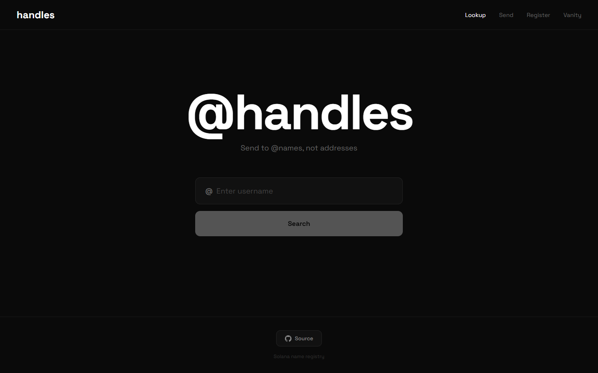

# solana-name-registry

Register a short `@handle` that points to a Solana wallet, then look it up or send SOL to it by name.



The repo has three parts:

| Path | What it is |
|---|---|
| `programs/alias-registry` | Anchor program that stores each handle in a PDA and charges a yearly fee into a treasury PDA |
| `api` | Express server that resolves, checks and registers handles, using Supabase first and the on-chain account as a fallback |
| `web` | React + Vite app with Lookup, Send, Register and Vanity tabs, plus a profile page at `/@name` |

## The program

`programs/alias-registry/src/lib.rs` has four instructions:

- `register_alias(alias, duration_years)` creates the account at seeds `["alias", alias]`. Handles are 3 to 15 characters, letters, digits or `_`, registered for 1 to 10 years.
- `transfer_alias` moves a handle to a new owner. Only the current owner can sign, it fails once the handle has expired, and it clears the verified flag.
- `renew_alias(duration_years)` extends from the current expiry, or from now if the handle has already expired.
- `set_verified(bool)` is gated on `ADMIN_PUBKEY`, which is all zeros until you set your own key.

Fees go to the PDA at seeds `["treasury"]`. The base is 0.1 SOL per year, times 50 for 3-character handles, 20 for 4 characters and 5 for 5 characters.

Each `AliasAccount` stores the handle, owner, created and expiry timestamps, a verified flag and the bump. The program emits `AliasRegistered` and `AliasTransferred` events.

Program ID: `DkbdTSGUTomGLViLXtxvLMeQYQyrtmRxZ8B7MxpnbvHv` (in `Anchor.toml`, `lib.rs` and `api/.env.example`). It is not deployed. Run `anchor keys sync` after generating your own program keypair.

## The API

`api/src/index.ts` exposes:

| Route | Behaviour |
|---|---|
| `GET /resolve/:alias` | Looks in the Supabase `aliases` table, then decodes the program account. Returns 410 for an expired handle |
| `GET /check/:alias` | Whether a handle is free |
| `POST /register` | Inserts `{ alias, address }` into Supabase |
| `GET /lookup/:address` | Reverse lookup of every handle for a wallet |
| `GET /fee/:alias?years=N` | Same fee formula as the program |

## The web app

- **Lookup** resolves a handle and shows the wallet's SOL balance, SPL token account count and recent transaction count.
- **Send** resolves a handle and sends SOL through Phantom, or shows the address for a manual transfer.
- **Register** writes a handle and address to Supabase.
- **Vanity** grinds keypairs in the browser until the address starts with your prefix.

The web app reads and writes the Supabase `aliases` table directly. It does not call the program, so on-chain registration is done with the Anchor client (see `tests/alias-registry.ts`).

## Getting started

Requirements: Node 20+. For the program you also need Rust, the Solana CLI and Anchor 0.29.

### Web app

```bash
cd web
cp .env.example .env    # optional, see below
npm ci
npm run dev             # http://localhost:5173
```

| Variable | Default |
|---|---|
| `VITE_RPC_URL` | `https://api.mainnet-beta.solana.com` |
| `VITE_SUPABASE_URL` | `http://127.0.0.1:54321` (a local `supabase start`) |
| `VITE_SUPABASE_ANON_KEY` | placeholder, set it to your project's anon key |

The UI loads without Supabase. Lookups and registration need a Supabase project with an `aliases` table holding `alias` (text, unique), `address` (text) and `created_at` (timestamptz, default `now()`).

### API

```bash
cd api
cp .env.example .env    # set SUPABASE_URL and SUPABASE_KEY
npm ci
npm run dev             # http://localhost:3001
```

### Program

```bash
npm install
anchor build
anchor test             # starts a local validator and runs tests/alias-registry.ts
```

## CI

`.github/workflows/ci.yml` type-checks and builds the web app and type-checks the API.

## License

MIT, see [LICENSE](LICENSE).
